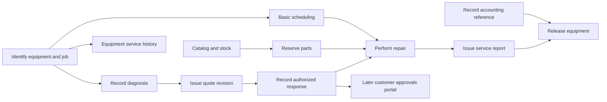

# Bootstrap intake architecture and delivery boundary analysis

This is the historical analysis and design discussion against the original source. The accepted changes are now implemented; see the [implementation and matched disposable-consumer comparison](bootstrap-intake-implementation-2026-10-23.md) for current results. Statements below about implementation not having begun describe their original discussion stage.

The proposed direction is sound: bootstrap should understand the supplied product vision across its architectural relationships, establish an agreed baseline and a useful roadmap, and leave each selected deliverable’s detailed behavior to specification intake. The strongest finding is a mismatch between the granularity of the input and the granularity of delivery selection. Current bootstrap can represent several candidate deliverables within one broad journey, but its first-entry handoff selects by source journey and requires one matching roadmap entry. A detailed vision can therefore become an oversized first specification even when finer candidates already exist.

The evidence supports changing that handoff and the definition of architectural completeness together. Simply asking fewer bootstrap questions would leave important relationships undiscovered. Simply asking more would not repair the selection rule.

The subsequent [design discussion](#design-discussion) changes the preferred fix: bootstrap recommends a starting outcome, while specification intake settles its exact delivery boundary. The original candidate-selection proposal below is analysis history rather than an accepted requirement to bind the first specification during bootstrap.

The accepted epic/feature model, feature-seed requirements and proposed implementation sections are consolidated in [Bootstrap epics and seeded feature specifications](bootstrap-intake-epics-design-2026-10-23.md).

This is an analysis for the Program Kit maintainer, dated 23 October 2026. Product changes remain proposals. Source is `969ccf04d90e9a539df402836c810dc54349bd7b`, fetched from `origin/main`. Branch is `codex/bootstrap-intake-analysis`, in `artifacts/worktrees/bootstrap-intake-analysis`. The original checkout’s unrelated edits were preserved. The only contribution changes are review documents.

## Agreed product intent

The user clarified three points during this analysis:

- Architecture decisions form a stable baseline that can change through deliberate impact review.
- Bootstrap must understand whatever detail the user supplies at the architectural level, including relationships and evolution. Neither a fixed number of journeys nor a fixed decomposition depth expresses the goal.
- The motivating observation was that a detailed description produced a first roadmap item containing many journeys, which then also entered the first specification. This was a hunch to investigate, rather than a supplied failed-run diagnosis.

The user subsequently requested a rich fictional intake exercise with pages, entities, lifecycles and future ideas. The resulting rehearsal used the shipped proxy-intake path in a disposable installed consumer. Its answers were simulated in the current session. The rehearsal stopped at draft intake; it did not execute the bootstrap workflow or create an actual first specification.

The desired separation is:

| Stage | Question it should settle | Useful result |
| --- | --- | --- |
| Bootstrap intake | What does this product vision mean, what relationships must survive its evolution, and what consequential choices remain? | Connected product understanding, provisional architecture, candidate outcomes and explicit uncertainties |
| Bootstrap architecture and roadmap | Which baseline do we adopt, and what useful deliverables depend on which others? | Accepted architectural decisions and an agreed, prioritized roadmap with clear boundaries |
| Specification intake | What exactly will this selected deliverable do within that architecture? | Detailed actor journeys, policies, lifecycles, failures, acceptance examples and explicit non-goals |
| Planning | How will those requirements be realized and verified? | Concrete technical design and work decomposition |

The existing distinction between intake confirmation and architecture approval should remain. A roadmap can be drafted and discussed during intake, but the final architectural baseline and roadmap currently emerge later in bootstrap. Moving final agreement into the conversational intake itself would be a separate workflow change.

## Current behavior and ownership

### Bootstrap deliberately favors the first useful outcome

The [bootstrap command](../../extensions/program-kit-governance/commands/speckit.program-kit-governance.bootstrap.md) directs intake to start with the first useful outcome and keep future journeys as actor/outcome summaries with minimal interactions. [Functional discovery](../../extensions/program-kit-governance/references/functional-discovery.md) asks for a coherent first functional baseline, including lifecycle, permissions, material rejection paths, experience and acceptance examples. The [intake method](../../extensions/program-kit-governance/references/intake-method.md) further requires a walkthrough of the first journey before convergence.

These instructions explain why an interview can spend disproportionate effort making the first journey believable. They also contain useful limits: future implementation detail belongs at its specification trigger, supplied answers must be reused, and technical defaults do not establish business policy. The problem is the balance and receiving contract, rather than an absence of guidance about deferral.

### The strategic model already contains much of the needed architecture

The [architecture schema](../../extensions/program-kit-governance/references/architecture-map.schema.json), [authoring contract](../../extensions/program-kit-governance/references/intake-artifacts.md) and [map validator](../../extensions/program-kit-governance/scripts/architecture_map.py) support:

- Classified subdomains, proposed bounded contexts, language, owned data, invariants, lifecycle and split triggers.
- Explicit cross-context contract, translation, consistency and failure ownership.
- Founding decision candidates with alternatives and evidence, kept distinct from Accepted ADRs.
- Individually preserved source journeys and multiple candidate slices referencing a journey.
- Compound candidates that explicitly include supporting journeys.
- Provisional discovery journeys with no invented steps when their boundary is unresolved.

The basic ability to preserve seven broad journeys and identify many smaller outcomes already exists. A new entity registry or a parallel architecture model is unnecessary to establish that ability. Important identity and lifecycle meaning currently lives partly in prose and context fields; it is not a complete machine-readable domain model.

### Roadmap generation is later and imposes a coarse first boundary

The [bootstrap workflow](../../workflows/program-kit-bootstrap/workflow.yml) performs assessment and research, constitution review, architecture and tooling work before roadmap generation and final bootstrap review. The [roadmap command](../../extensions/program-kit-governance/commands/speckit.program-kit-governance.roadmap.md) defines a portfolio of candidate specifications with outcomes, ownership, dependencies and recommended sequence. It explicitly distinguishes specification readiness from implementation readiness and permits Candidate or Blocked work.

However, `first_slice` in the [decision schema](../../extensions/program-kit-governance/references/bootstrap-decisions.schema.json) names source `journey_ids`, an outcome and rationale. It cannot select a particular candidate outcome within a source journey. The roadmap branch of `stage_plan()` in [bootstrap_context.py](../../extensions/program-kit-governance/scripts/bootstrap_context.py) gathers all candidates intersecting those journeys and tells the roadmap author to put them in exactly one first entry. `first_feature()` in [bootstrap_handoff.py](../../extensions/program-kit-governance/scripts/bootstrap_handoff.py) requires exactly one entry covering the selected source-journey boundary.

This rule protects a deliberately cohesive compound first outcome, but it also treats a broad source description as a delivery boundary. Those meanings need to be separated. It does not automatically put every product journey into the first entry; the risk is specifically the journeys selected by `first_slice` and the candidates associated with them.

### Feature intake deepens behavior but does not choose a smaller first commission

The [feature intake command](../../extensions/program-kit-governance/commands/speckit.program-kit-governance.specification-intake.md) already asks for actors, outcome, priority, independent acceptance examples, failure cases and dependencies, while preserving settled architecture and product meaning. Its [structured brief](../../extensions/program-kit-governance/scripts/specification_intake.py) requires substantive scope, non-goals, journeys and acceptance criteria, plus decisions and provenance.

That is an appropriate place for much of the detailed work the user describes. It cannot reliably repair an oversized commissioned outcome merely by deepening it: it first needs permission and guidance to challenge the delivery boundary itself.

The [architecture-check command](../../extensions/program-kit-governance/commands/speckit.program-kit-governance.architecture-check.md) requires semantic comparison with applicable constraints and Accepted ADRs. [Feature knowledge](../../extensions/program-kit-governance/scripts/feature_knowledge.py) projects relevant contexts, contracts, decisions and relationships. These are useful foundations for preserving future seams. Their structural checks do not prove that arbitrary free-text requirements are semantically compatible.

## Rich input rehearsal

### Scenario and method

The [fictional scenario](bootstrap-intake-analysis-2026-10-23/scenario.md) contains 2,001 whitespace-delimited words across six page sections. WorkshopFlow is an equipment repair business with two branches. It describes seven broad work areas: receiving, diagnosis and agreement, parts supply, repair execution, billing and collection, history and recurring care, and administration with later external access.

The input includes customer/contact distinctions, equipment and job identities, mutable serial numbers, quote revisions and approval, independent parts/work states, stock reservation, supplier uncertainty, safety review, custody, accounting authority, historical privacy, warranty, future portals and possible franchise evolution. It lists many pages without assigning them technical boundaries or preselecting a roadmap. It asks for useful delivery sequencing and identifies loss of diagnosis/approval evidence as the main pain.

Setup used `Start-IntakeSession.ps1 -PrepareOnly -KeepWorkspace -IdeaFile ...`, which installed all eight candidate components in a disposable consumer. The installed front-door and shipped grilling method governed the rehearsal; `proxy_intake.py begin --scope full-intake` recorded simulated provenance before authoring. No separate coding worker was launched.

The [retained transcript](bootstrap-intake-analysis-2026-10-23/transcript.md) contains thirteen authored questions across four subject rounds:

| Round | Questions | What they resolved |
| --- | --- | --- |
| Purpose and authority | Q1–Q3 | First useful result, approval actors, independent lifecycle dimensions |
| Identity and boundaries | Q4–Q8 | Historical revisions, branch access, stock consistency, accounting authority, future warranty links |
| First outcome and experience | Q9–Q11 | Concrete quote walkthrough, partial-approval scope, list/detail interaction and recovery |
| Portfolio challenge | Q12–Q13 | Independent delivery prerequisites and missing relationships across future areas |

Nine questions addressed architectural meaning or portfolio relationships, one selected the first useful scope, and three explored first-outcome behavior or experience. This classification is an analytical judgment about these questions. The count describes this disclosed same-session rehearsal; it is not a measurement of what an independent agent would ask, an expected minimum, or a token/cost result. The interviewer already knew the hypothesis under investigation, which limits behavioral conclusions.

### Draft output and architectural quality

The installed authoring builder produced a valid draft with seven source journeys, nineteen candidate outcomes, four proposed contexts and five typed cross-context relationships. The contexts separate service agreements, parts supply, workshop execution and financial handoff. They are logical ownership proposals, not a decision to deploy four services. The builder produced the canonical JSON map, Structurizr DSL and draft intake; `bootstrap_intake.py validate-draft --json` and `proxy_intake.py verify` both passed.

The draft connects several important architectural seams:

- Party identity, authenticated user, approving contact and equipment owner are distinct.
- Quote approval names an issued revision; later price or diagnosis changes cannot silently acquire that approval.
- Commercial approval, parts availability, physical work and financial conditions have independently owned lifecycles.
- Parts owns reservation and consumption consistency; job approval does not imply an atomic stock transaction.
- Accounting remains the financial authority, while the application owns references and eventual reconciliation.
- Warranty and portal evolution preserve source relationships and privacy without deciding all later policies.

That is enough to propose an initial ownership model and investigate founding decisions. It is not a complete architecture acceptance case. In particular, the candidate outcomes have no structured dependency or priority fields, the future interactions remain broad, and the exact shared authorization model and history contracts still need architectural challenge. The proposed access scope is partly prose. A production retention requirement, stricter consistency need or materially different future audience could revise the baseline.

The rehearsal also illustrates how detail can move later: exact quote fields, option combinations, ceiling calculations, warranty entitlement, recurring-contract billing, serial tracking, supplier APIs and payment-provider behavior retained feature or deployment triggers. Their architecture-significant consequences were preserved instead of treating all omitted detail as irrelevant.

### What the questions establish

The questions were sufficient to author a coherent provisional model for this scenario. They were not sufficient by themselves to establish an agreed roadmap graph: Q12 supplied useful prerequisite reasoning, but the artifact contract did not require representing it as a graph, distinguishing hard dependencies from preferences, or justifying each deliverable’s size.

The current method allows a capable interviewer to do the whole-vision work. It does not consistently require that work at the same depth across all architecture-significant relationships. In particular, first-journey convergence can look complete before the portfolio has been checked for shared identity, chronology, ownership and irreversible effects.

No actual generated roadmap or first specification was observed in this rehearsal. The downstream findings below come from focused execution of the existing selection functions and source inspection, with their scope stated separately.

## Reproduced handoff behavior

### One broad journey cannot freely select one of its candidate deliverables

A bounded fictional probe used the real authoring builder to validate one source journey containing two candidate outcomes. The actual roadmap stage plan selected both candidates for the first entry. Placing those candidates in separate otherwise parseable roadmap entries caused `first_feature()` to reject the handoff with:

```text
FIRST-SLICE-HANDOFF: roadmap must identify one entry covering the selected first journey boundary through exact canonical candidate IDs
```

A second probe used the actual WorkshopFlow draft. A hypothetical first selection referencing `vision-repair`, with a stated intent to perform an authorized repair while keeping other candidates separate, yielded these required first-entry candidates:

```text
schedule-job
perform-repair
issue-report
```

This second selection was diagnostic input to the actual stage-plan function, never saved as an approved consumer decision. It demonstrates the coarse selection mechanism on the rich draft; it does not claim that a complete bootstrap worker chose that first outcome. It supplies a concrete explanation consistent with the user’s observation, without establishing the cause of an unavailable historical run.

### The future portfolio summary loses descriptive fields

`create_documents()` in [bootstrap_context.py](../../extensions/program-kit-governance/scripts/bootstrap_context.py) filters the selected first journeys and projects future ones using `id`, `name` and `outcome`. Canonical intake journey records contain `id`, `statement` and `evidence`. Executing the exact projection block with records in that valid shape yielded only an ID for a later journey.

The canonical architecture model still contains the strategic journey and its outcome, so this is a lossy summary rather than destruction of the full source. It nevertheless weakens the compact representation of the future vision, especially when the stage instructions emphasize using the supplied brief.

### Feature context does not project every form of future journey

`feature_knowledge.project()` selects journeys through their step relationship IDs. A diagnostic model object containing a discovery journey with no steps projected zero journeys, even with whole-model fallback. This was a direct projection observation, not a validated full discovery-consumer exercise. The schema explicitly permits this kind of unresolved journey, but the receiving projection lacks a separate selection route for it. It also does not include the candidate-slice collection in its strategic projection.

If future seams are to be first-class specification context, explicit candidate/source identity and relevant unresolved neighbors need a receiving path beyond step matching. Missing optional history should still not become a new blanket specification gate.

### Durable confirmation is intentionally separate from architecture conformance

A fictional feature brief was reviewed and confirmed with clearly simulated fixture provenance. Changing the architecture model afterward did not invalidate its unchanged product confirmation through `specification_intake.check()`. The existing focused tests also preserve confirmation across unrelated governance changes.

That preservation is useful and should remain. It means an intake confirmation is not proof of current architectural compatibility. Affected architecture must be reassessed through the existing scope/review mechanisms when it changes, while unchanged product answers remain settled. Restoring global fingerprint invalidation or bootstrap prerequisite receipts would undermine the repository’s current consumer-engineering direction.

## Proposed responsibility boundary

Bootstrap should stop asking when further detail does not change the architectural understanding or the ability to define useful delivery boundaries. It should continue asking when a different answer would change shared meaning, ownership, a lifecycle boundary, identity, trust, consistency, external obligations or the deliverable graph.

| Topic | Establish during bootstrap | Deepen during specification or planning |
| --- | --- | --- |
| Entities and IDs | Important concepts, identity continuity, ownership, cross-context references and historical links | Complete fields, validation, storage keys and physical representation unless externally constrained |
| Lifecycles | Independently evolving subjects, major transitions, irreversible effects and shared invariants | Exact transition tables, detailed admission rules and feature-specific alternatives |
| Technology | Supplied constraints, applicable defaults, strategic dependencies and consequential risks | Concrete implementation choices inside the accepted baseline; later production commitments at their trigger |
| UI | Intended access surfaces and architectural consequences of offline/native/accessibility needs | Detailed screen flows, navigation changes, controls and behavior for the commissioned outcome |
| External systems | Authority, contract ownership, information exchanged and uncertain-outcome responsibility | Provider fields, API shapes, retry timing and integration implementation |
| Future journeys | Relationships that constrain today’s choices, candidate outcomes, priority rationale and deferrals | Complete future policies, fields, screens and acceptance suites |
| Roadmap | Useful deliverables, explicit non-goals, real prerequisites and priority rationale | Detailed stories and operation/task decomposition for one selected commission |

“All entities and lifecycles” should mean all supplied concepts and architecturally consequential relationships are accounted for. Requiring every future field, state transition and identifier format would move exhaustive specification back into bootstrap. Conversely, simply retaining future ideas in a generic “later” list would fail the user’s goal.

C4 adds a second distinction: architectural abstraction level is different from functional detail. The official [C4 diagram guidance](https://c4model.com/diagrams) describes four static levels and says to use the levels that add value. Bootstrap should establish System Context and evidence-supported container choices, while strategic context and lifecycle models carry domain ownership. A bounded context, database entity and user journey are not interchangeable C4 elements. The current repository already separates these views and warns against inventing unsupported lower-level detail.

## Roadmap structure and first specification

A source description, a strategic journey, a roadmap deliverable, a specification story and an implementation operation serve different purposes. Preserve traceability among them while allowing different cardinalities. One broad journey can yield many deliverables; one cohesive deliverable can need several supporting journeys. Neither relationship automatically determines how much to commission first.

The WorkshopFlow example admits a graph such as the following. This is an analysis proposal, not a roadmap generated by the bootstrap workflow or an agreed product plan. Arrows denote prerequisites for the illustrated branch, not every possible delivery dependency. Priority can change independently where no prerequisite exists.



A product owner could deliberately commission diagnosis, quote issue and response together as one coherent useful slice. That should be an explicit decision about value and reviewable size. The source journey’s narrative length should not make that decision automatically. Inventory, scheduling and accounting handoff can also have useful earlier forms that do not require completing the entire repair business.

An agreed roadmap should cover the known vision at its current confidence, identify priorities and real dependencies, and distinguish provisional areas needing decomposition. It should not imply that all future requirements are known or every candidate is ready. The first specification should consume a clearly selected deliverable boundary, explicitly exclude its siblings, and reopen only missing detailed behavior or material architectural conflicts.

## Options and recommendation

| Option | Benefit | Limit |
| --- | --- | --- |
| Change interview wording alone | Makes whole-vision architecture more visible quickly | Leaves the reproduced first-entry selection constraint intact |
| Repair selection and align intake, roadmap and feature handoff | Reuses current artifacts while addressing the demonstrated granularity mismatch | Requires coordinated schema, projection, guidance and regression changes |
| Replace bootstrap and add a separate product-discovery lifecycle | Could redesign every phase around a new model | Adds migration and authority complexity before the existing mechanisms have been used fully |

The second option is recommended. A useful implementation sequence would be:

1. **Select delivery candidates explicitly.** Extend the existing first-selection contract so it can identify exact candidate outcomes or a deliberately composed boundary. Keep source-journey traceability separately. Preserve legitimate supporting journeys. A newly discovered sibling candidate must not silently enlarge an already selected first deliverable.
2. **Define whole-vision architectural convergence.** Update the front door, functional-discovery lens, intake method and final synthesis together. For each supplied area, account for identity, state evolution, ownership, shared constraints, cross-context effects and future seams at the required architectural depth. Keep detailed first-feature questions at their feature trigger unless needed to distinguish these boundaries.
3. **Make the roadmap graph inspectable.** Use the existing roadmap as the authoritative place for deliverable dependency and priority decisions. Make real entry references and the reason for a dependency distinguishable from narrative order and from architecture-design blockers. Generate graph views from that owner. If intake needs provisional relationships, carry them through its existing semantic source; do not maintain a second authoritative schedule or graph file.
4. **Strengthen the feature receiving context.** Carry selected candidate IDs, source lineage, relevant accepted constraints and neighboring future contracts into the existing feature brief/context. Include relevant unresolved discovery neighbors without inventing their behavior. A missing subject detail is a specification question; a shared-boundary change is an architecture impact decision.
5. **Preserve existing consumers.** Keep accepted maps, history, locks and unchanged feature confirmations. Read legacy journey-based selections as legacy contracts rather than silently assigning new candidate scope. Ambiguous new decomposition needs a scoped reviewed choice; no global rebootstrap or automatic expansion of existing first specifications.

Exact field names and migration behavior remain design choices for a subsequent implementation proposal. This analysis does not recommend another approval ledger, machine-readable entity dossier, mandatory exhaustive lifecycle diagram set, or repeated ratification for ordinary feature work.

## Acceptance criteria for a later change

The later implementation should demonstrate behavior rather than require particular question counts:

| Scenario | Expected evidence |
| --- | --- |
| Seven broad areas with rich shared relationships | All supplied architecture-significant meaning remains traceable; no fixed seven-or-thirty decomposition target |
| Two useful candidates from the same source journey | Either can be selected without automatically commissioning the other |
| One explicitly cohesive outcome spans several journeys | Supporting journeys remain grouped when deliberately selected; source identities survive |
| A sibling candidate is added later | Previously selected scope remains stable unless a substantive dependency requires review |
| Future lifecycle or external actor constrains current identity | Bootstrap discovers and records the relationship without specifying the entire future feature |
| Future detailed policy has no present architectural consequence | Owned deferral survives; it neither expands the first specification nor blocks unrelated work |
| Same vision is presented as pages, one narrative, or several named journeys | Presentation differences do not alone determine delivery size |
| Roadmap dependency differs from commercial preference | Graph prerequisites and recommended order are separately understandable; cycles and unsupported links surface |
| Feature detail fits accepted boundaries | Specification intake deepens it without reasking settled whole-product questions |
| Feature detail changes shared ownership or historical meaning | Existing architecture review surfaces the conflict and its impact before dependent implementation |
| Relevant discovery journey has no steps yet | Its uncertainty remains visible to the affected feature instead of disappearing from context |
| Toolkit metadata or unrelated architecture changes | Unchanged product confirmation survives; affected semantic review remains separate |

Focused regressions belong with the existing authoring, bootstrap handoff/context, feature knowledge and specification-intake owners. Installed representation matters because these commands become generated consumer skills. Update the maintained validation inventory only for actual changed contracts. Broad browser, native runtime or bootstrap matrices would not establish interview quality or solve this scope problem.

## Execution evidence and limits

| Check | Actual result | Scope |
| --- | --- | --- |
| Remote sync | Fetched `main`; local and remote both `969ccf0` | Source selection, not product validation |
| Disposable preparation | All eight components installed; consumer retained | Actual installer and installed intake surface; no worker started |
| Rich draft builder | Passed; seven journeys, nineteen candidates, four contexts | Draft structural and cross-artifact validation |
| Draft intake validation | Passed | Bound draft consistency; architecture remains provisional |
| Proxy verification and authority guard | Passed verification; authority guard rejected promotion; zero workflow runs | Simulated provenance and stopping boundary |
| Candidate-selection probes | Reproduced coarse first-entry selection and split-entry rejection | Existing functions with fictional inputs; no full roadmap-worker claim |
| Projection probes | Reproduced ID-only future summary and omission of step-free discovery journey | Exact future-summary block; direct feature-projection call |
| Focused maintained checks | `validate_feature_knowledge` passed in 0.176s; `validate_specification_intake` passed in 2.746s; runner total 3.82s | Existing bounded behavior, no independent interview acceptance |

Final document validation is recorded in the companion [validation note](bootstrap-intake-analysis-2026-10-23/validation.md). Initial diagnostic attempts encountered the sandbox temporary-directory ACL restriction and an unprepared schema runtime. Using a writable temporary directory and the shipped pinned-runtime setup resolved them. The first restricted setup lookup failed DNS; normal external-process access completed the pinned setup. These were local setup issues, not intake product failures. Original failed probe outputs were retained, along with the successful attempt. A descriptor lookup used a wrong section name before the correct descriptor was read. Semantic review also clarified a read-only parts lookup description so it could not be confused with the separate consumption command; both draft-build outputs remain available.

Local retained evidence, relative to the analysis worktree:

- `artifacts/intake-analysis/product-idea.md`, `probe.py`, `probe-output.txt`, `probe-output-02.txt`, `probe-output-03.txt`, `review_probe.py`, `review-probe-output.txt` and `rehearse.py` preserve the fictional inputs and diagnostics.
- `artifacts/intake-sessions/2c3d70267d9f44058ab4e92b93f84dcb/` contains the preparation record and preserved consumer archive.
- `artifacts/intake-analysis/temp/program-kit-intake-ekhf_bb8/docs/architecture/` contains the source, map, DSL, draft intake, proxy transcript, two build logs and proxy verification result.
- `artifacts/validation-runs/20261023T181311Z-7a2b049e/results.json` records the focused maintained checks against unchanged product source.

The scenario and transcript are copied into this review folder so their content remains reviewable with the branch. Larger generated artifacts and local logs remain ignored evidence. An independent bootstrap run, actual first specification and human acceptance were outside this exercise, so the report makes no claim about their observed behavior. The proposed change now has a demonstrated mechanism to address, a concrete responsibility boundary and bounded acceptance cases; implementation can be chosen separately.

## Design discussion

After requesting a grilling discussion about the fix, the user answered “Accept all” to the following three recommendations. This settles those recommendations only; it does not approve an unseen implementation design or later questions.

| Decision | Accepted recommendation | Consequence |
| --- | --- | --- |
| Q1 First specification selection | Bootstrap produces an agreed roadmap and recommended starting outcome. Specification intake settles the exact commission, explaining material splits, combinations or priority changes. | Repairing candidate IDs alone is insufficient if bootstrap still binds the first specification's complete scope. Trace the existing first-selection dependencies through assessment, context, roadmap and closure. |
| Q2 Delivery unit | A deliverable serves one meaningful user objective with an observable outcome a person can independently review and accept. Split for useful outcomes rather than screens, entities or endpoints. Explicit workable existing manual processes can bridge later capabilities. | The rehearsal's nineteen candidates are discovery material, not nineteen accepted specification boundaries. Reassess operation-level candidates for cohesion. |
| Q3 Future architectural consequence | Establish shared identity and ownership meaning and future access relationships during bootstrap. Detailed future policies belong to their specification. Investigate further wherever alternative answers would invalidate the shared model. | “Portal later” cannot replace architectural analysis; future infrastructure and complete portal policy need not be implemented or specified now. |

Stable architecture with deliberate impact review, preservation of the supplied vision and source traceability remain settled from the earlier discussion. Implementation has not begun. Remaining product questions concern how speculative ideas appear in the agreed roadmap and how specification-time scope refinements are reviewed.

The user then challenged Q5's implicit one-roadmap-item/one-specification assumption. They proposed that a complex roadmap item such as Policy management could encompass evidence analysis, renewal, deletion and cleanup through several specifications, and subsequently endorsed that separation. They suggested roadmap items correspond to epics and specifications to features. The useful-outcome discipline therefore applies at the feature delivery level while a broader roadmap capability can retain several specifications. Domain ownership and roadmap scope remain distinct: one domain can support several deliveries over time, and a delivery can involve several owners. The exact schema design and parent completion semantics remain to be settled; the epic/feature analogy does not itself settle them.

Current source needs explicit one-to-many support for independently scoped specifications: `specification_intake.directory()` keys a single brief and confirmation by roadmap entry ID, and `check_spec()` validates each spec against that same entry's current brief. Several files can reference one brief, but this does not provide separate durable intake scopes for the child specifications. The specification-oriented roadmap guidance also needs alignment. The optional legacy `verify_delivery` audit assumes exactly one owned feature; this is historical audit behavior, not an ordinary runtime gate to restore.

The user added an explicit input-preservation requirement: some users arrive with substantial feature detail and carefully considered specification boundaries. Bootstrap must recognize that work, use targeted grilling to understand and challenge the proposed boundaries in relation to other boundaries, and retain the supplied detail as seeded input for later specification intake. It must not force a detailed vision back into a vague summary or recreate discovery from scratch when the feature is selected. User-supplied boundaries are evidence to assess, rather than boundaries to automatically discard or mechanically accept. Supplied details, inferred proposals, unresolved questions and the reason for any revised boundary must remain distinguishable. Detailed future input should be preserved even when further detailed questioning belongs later. Seed storage and feature-identity mechanics are implementation design work, not authorization to create all future feature branches or specifications now.

The user subsequently accepted the recommendations that roadmap items act as epics, specifications act as features, epics complete against their agreed outcomes, and detailed input carries forward into feature seeds. They also accepted Q4: preserve detailed exploratory ideas separately from intended roadmap commitments; the amount of detail does not imply a commitment to delivery. The product-model questions from the grilling discussion are settled. The consolidated design above maps the accepted direction to existing implementation owners and proposed review sections; product implementation has not begun.
