# Diagnostic epic roadmap projection

PROXY_REHEARSAL: simulated answers; no user confirmation or authorization.

This is a deterministic view of authored comparison records, outside the consumer. It is not a bootstrap-generated or approved roadmap.

<!-- PROGRAM-KIT:ROADMAP-VIEW:START -->
## Specification roadmap view

> Derived navigation view only. `docs/architecture/specification-roadmap.md` is the authoritative source for roadmap-entry status.

| Roadmap entry | Title | Authoritative status | Feature seeds |
| --- | --- | --- | --- |
| `EPIC-001` | Reception and repair agreements | `Candidate` | `admit-service-job`, `manage-repair-agreement` |
| `EPIC-002` | Parts supply | `Candidate` | `manage-branch-stock`, `reserve-parts-for-job`, `procure-parts-manually` |
| `EPIC-003` | Workshop work and reports | `Candidate` | `schedule-work`, `complete-repair-and-report` |
| `EPIC-004` | Collection and accounting handoff | `Candidate` | `release-equipment`, `reconcile-accounting` |
| `EPIC-005` | History and care | `Candidate` | `inspect-service-history`, `handle-warranty-case`, `plan-recurring-care` |
| `EPIC-006` | Staff and external access | `Candidate` | `administer-staff-scope`, `customer-self-service`, `supplier-self-service` |
| `EPIC-007` | Possible franchise product | `Candidate` | `franchise-option` |

Epic membership does not imply a dependency on every sibling feature. Completion follows the agreed epic outcomes, not the number of completed children.

```mermaid
flowchart TD
  epic_EPIC_001["EPIC-001: Reception and repair agreements"]
  epic_EPIC_001 -. contains .-> feature_admit_service_job["admit-service-job"]
  epic_EPIC_001 -. contains .-> feature_manage_repair_agreement["manage-repair-agreement"]
  epic_EPIC_002["EPIC-002: Parts supply"]
  epic_EPIC_002 -. contains .-> feature_manage_branch_stock["manage-branch-stock"]
  epic_EPIC_002 -. contains .-> feature_reserve_parts_for_job["reserve-parts-for-job"]
  epic_EPIC_002 -. contains .-> feature_procure_parts_manually["procure-parts-manually"]
  epic_EPIC_003["EPIC-003: Workshop work and reports"]
  epic_EPIC_003 -. contains .-> feature_schedule_work["schedule-work"]
  epic_EPIC_003 -. contains .-> feature_complete_repair_and_report["complete-repair-and-report"]
  epic_EPIC_004["EPIC-004: Collection and accounting handoff"]
  epic_EPIC_004 -. contains .-> feature_release_equipment["release-equipment"]
  epic_EPIC_004 -. contains .-> feature_reconcile_accounting["reconcile-accounting"]
  epic_EPIC_005["EPIC-005: History and care"]
  epic_EPIC_005 -. contains .-> feature_inspect_service_history["inspect-service-history"]
  epic_EPIC_005 -. contains .-> feature_handle_warranty_case["handle-warranty-case"]
  epic_EPIC_005 -. contains .-> feature_plan_recurring_care["plan-recurring-care"]
  epic_EPIC_006["EPIC-006: Staff and external access"]
  epic_EPIC_006 -. contains .-> feature_administer_staff_scope["administer-staff-scope"]
  epic_EPIC_006 -. contains .-> feature_customer_self_service["customer-self-service"]
  epic_EPIC_006 -. contains .-> feature_supplier_self_service["supplier-self-service"]
  epic_EPIC_007["EPIC-007: Possible franchise product"]
  epic_EPIC_007 -. contains .-> feature_franchise_option["franchise-option"]
  feature_admit_service_job -->|"feature prerequisite"| feature_manage_repair_agreement
  feature_admit_service_job -->|"feature prerequisite"| feature_reserve_parts_for_job
  feature_manage_branch_stock -->|"feature prerequisite"| feature_reserve_parts_for_job
  feature_manage_repair_agreement -->|"feature prerequisite"| feature_procure_parts_manually
  feature_manage_branch_stock -->|"feature prerequisite"| feature_procure_parts_manually
  feature_admit_service_job -->|"feature prerequisite"| feature_schedule_work
  feature_manage_repair_agreement -->|"feature prerequisite"| feature_complete_repair_and_report
  feature_reserve_parts_for_job -->|"feature prerequisite"| feature_complete_repair_and_report
  feature_schedule_work -->|"feature prerequisite"| feature_complete_repair_and_report
  feature_complete_repair_and_report -->|"feature prerequisite"| feature_release_equipment
  feature_release_equipment -->|"feature prerequisite"| feature_reconcile_accounting
  feature_admit_service_job -->|"feature prerequisite"| feature_inspect_service_history
  feature_inspect_service_history -->|"feature prerequisite"| feature_handle_warranty_case
  feature_inspect_service_history -->|"feature prerequisite"| feature_plan_recurring_care
  feature_schedule_work -->|"feature prerequisite"| feature_plan_recurring_care
  feature_manage_repair_agreement -->|"feature prerequisite"| feature_customer_self_service
  feature_procure_parts_manually -->|"feature prerequisite"| feature_supplier_self_service
```

Feature prerequisite edges use canonical declared contracts. Priority and preferred sequencing remain in the epic records; missing edges are not proof of independence.
<!-- PROGRAM-KIT:ROADMAP-VIEW:END -->
