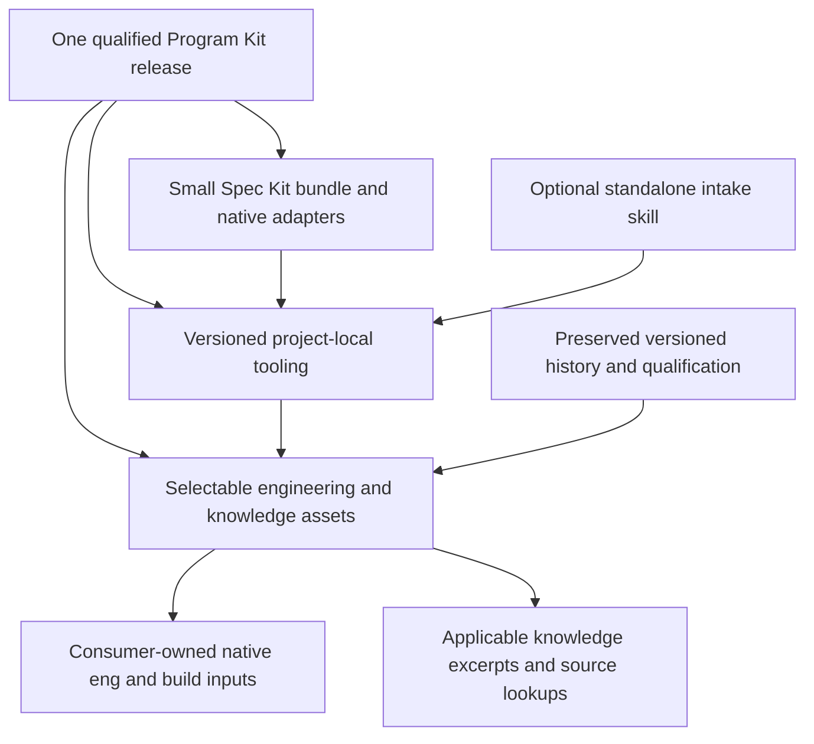

# Program Kit distribution and knowledge review

Initial review: 2026-10-23. Expanded analysis and grilling: 2026-10-24. Status: retained investigation and discussion history. The user subsequently narrowed current scope to internal modularity; the [current design synthesis](modularity-design-2026-10-24.md) supersedes the broader implementation proposals below. Future packs are tracked in [issue #57](https://github.com/orbyss-io/program-kit/issues/57).

Reviewed checkout: `artifacts/worktrees/bootstrap-intake-analysis`, branch `codex/bootstrap-intake-analysis`, commit `4a3455ca2366121e8bc1cab4ad9e4f4cdbbb57f5`. The checkout was clean before this review. The separate main checkout has unrelated modifications and was not changed. The branch's [epic/intake improvements](bootstrap-intake-implementation-2026-10-23.md) remain the baseline.

## Recommendation

Keep Spec Kit as the integration and lifecycle layer. Separate its small bundle manifest from the complete Program Kit tooling distribution. Then separate reusable runtime code, selected engineering assets, applicable knowledge, optional examples and historical maintenance material by their actual consumers.

Do this incrementally. There is a strong case for separating distribution responsibilities, but moving everything to standalone skills immediately would replace useful native registration, hooks, integration rendering and update ownership with work we would have to maintain ourselves. Conversely, fitting more material into packs does not resolve unnecessary installation or weak knowledge discovery.

Separating the bundle carrier from the toolkit carrier can address the immediate archive limit while preserving the existing native components. The expanded user intent below requires a broader capability/pack and context design before treating that packaging change as the complete approach. The original implementation sections remain proposals whose order and scope must be reconciled with the grilling.

## Expanded target: a modular toolbox of Program Kit packs

The user's 2026-10-24 clarification establishes three strong concerns together: dependable knowledge use, simpler toolkit maintenance, and appropriate consumer content. The user accepts the recommended priority order while asking for controlled enablement, future extensibility and less agent-context overload. This is an analysis/design request, not authority to implement or publish the resulting system.

The backend examples were illustrative. The broader future product is a toolbox where people can author, obtain and install additional knowledge and engineering capabilities, comparable in experience to choosing development-tool extensions. The user's Semantic Kernel example means a pack should make its capabilities discoverable during feature specification and supply applicable knowledge during implementation. It does not authorize a Semantic Kernel integration, prescribe its APIs or establish a current support claim.

Proposed terminology: **Program Kit pack** for a versioned optional capability contribution. Reserve **Spec Kit extension** for the actual native integration primitive. A pack may eventually contribute knowledge, capability descriptions, examples, engineering assets/tools, and native adapters where needed. The exact permitted content, extension contract and first implementation scope remain grilling questions. A gallery, marketplace, hosted registry, independent lifecycle or replacement backend is not implied by the analogy.

### Keep separate controls for separate responsibilities

| Control | What it answers | Proposed behavior / unresolved design |
| --- | --- | --- |
| Installed availability | Are these exact pack bytes present and usable? | Controlled acquisition, explicit identity/version and owned updates; an installed pack does not automatically alter an application. Exact distribution mechanism remains open. |
| Project/component adoption | Which capabilities/providers does this project or component actually use? | Resolve accepted selections plus their necessary dependency closure. Declare why a capability is present; support mixed projects without a global stack assumption. Detailed activation/default policy remains open. |
| Task/decision context | Which knowledge does this actor need for this decision now? | Select from applicable adopted capabilities and actual task ownership. A pack's availability or adoption must not cause its complete prose to appear in every prompt. |
| Engineering execution | Which real checks, generation and restore operations apply? | Execute through the existing owners and their actual prerequisites. Disabling a convenience feature must not waive a selected contract's required constraints or ordinary engineering safeguards. |
| Support/compatibility | What behavior is actually qualified for this pack/version/composition? | Distinguish available reference, guided use and tested managed support. Future extension points do not establish Node/Python/Semantic Kernel acceptance. |

The core should be defined by responsibilities, not by whichever files are currently imported together. The subsequent author/consumer clarification makes pack identity, contract validation, capability resolution and focused knowledge/tool access candidate shared-core responsibilities. Intake and the native Spec Kit lifecycle are consumer responsibilities rather than prerequisites for every pack authoring operation. The precise minimum is open in Q6. Stack-specific generators, rules and provider contracts belong to their capability owners. Mandatory constraints still need phase/decision applicability: declaring something core should not mean pasting its full text into every turn.

### Pack authors and application consumers need different installation profiles

The next user clarification accepts Q3's optional contribution layers and explicitly accepts Q5's progressive context recommendation. It adds a pack development kit, including authoring skills, so an author can produce compatible packs from existing software or a useful technology combination without installing the complete consumer lifecycle. Application consumers continue to use full Spec Kit integration and lifecycle management.

This revises the universal reading of Q2: **Spec Kit remains the consumer lifecycle foundation; it need not be a prerequisite for core pack authoring and standalone pack operations.** The Program Kit product identity and Q2a's native consumer phase vocabulary remain settled. These are usage/installation profiles, not mutually exclusive human roles: one developer can both author packs and build applications.

| Proposed profile | Purpose | Candidate contents and boundaries |
| --- | --- | --- |
| Program Kit Core | Understand and use compatible packs outside a particular application lifecycle | Minimal shared pack contract/identity, declared dependency/capability resolution and focused knowledge/tool access. Exact operations and installation mechanism remain Q6/design decisions. |
| Program Kit Pack SDK / development kit | Author, inspect, test and package contributions in an ordinary existing source repository | Core plus a pack-authoring skill, contract documentation/schemas, templates, deterministic validation and packaging/test helpers. No mandatory bootstrap, full Spec Kit lifecycle, .NET payload or unrelated provider packs. |
| Program Kit consumer profile | Use adopted packs throughout application intake, specification, planning, implementation and verification | Core plus native Spec Kit lifecycle adapters and chosen engineering/knowledge capabilities. The full lifecycle does not imply installing every optional pack. |
| Scoped integration test consumer | Demonstrate a pack's claimed Spec Kit/application behavior | Real relevant consumer installation and prerequisites for that test. This can be disposable or CI-owned without becoming a prerequisite for authoring a knowledge-only pack. |

These are proposed responsibility boundaries, not four independently maintained implementations or a settled four-package release scheme. Keep one contract and shared owners. The minimum profile must have an explicit useful operational promise; "run packs" alone does not define whether the host offers knowledge queries, deterministic tools, native hooks, or agent lifecycle orchestration.

The current contributor [program-kit-development skill](../../.agents/skills/program-kit-development/SKILL.md) already guides repository changes without the consumer lifecycle, but is repository-specific. It is not a public third-party pack SDK. Existing [coding pattern authoring](../../extensions/program-kit-governance/scripts/coding_patterns.py:85) has useful precedent: local contributions cannot shadow canonical owners, compatibility and inputs are explicit, and real proof/review have distinct limits. It is currently a consumer-scoped pattern contract, not a general installable pack contract. Reuse suitable concepts without declaring the SDK already delivered.

Proposed authoring experience: select an existing source project or technology combination, declare the pack's bounded capabilities and versions, identify source-backed canonical knowledge, add only useful examples/integration assets, generate a draft through the authoring skill, then run deterministic contract and declared behavior checks. Capture dependencies, exclusions, provenance and unsupported cases. The skill assists authoring; executable validators and actual tests establish their stated claims. Combining technologies does not automatically qualify every package/version/application composition.

The eventual implementation should exercise its extension contract with an existing Program Kit family and a small external-source fixture whose author does not edit the Program Kit core. A hosted pack store, automatic publication, live coding worker and comprehensive backend implementations are not implied or authorized by this planning discussion.

### Configuration interview, device preparation and reproducible test consumers

The user subsequently accepts Q6 and Q7 and requires a grilling-style configuration interview at the installation front door. It establishes how the person intends to use Program Kit, their selected capabilities and the next operation. A read-only device assessment should produce an inspectable script appropriate to the actual device/shell for the user to run. This is tooling configuration, distinct from an application's product/domain intake; pack authors should not need to invent an application merely to configure the SDK.

This aligns with the existing [device toolchain policy](../../extensions/program-kit-governance/references/device-toolchain-policy.md): inspect actual device/manager state, preserve authoritative pins and existing installations, and leave device installation/update commands to the human terminal. The proposed wizard must not become an agent-run device installer. Its script should cover only selected role/pack/operation prerequisites, distinguish device preparation from project-local setup, show persistent changes and verification, and verify actual readiness afterward. Missing software remains missing until independently observed as ready; producing a script supplies no successful-installation evidence.

Current [initialize_device.py](../../scripts/initialize_device.py:19) delegates to the .NET-owned [device_toolchain.contributor](../../extensions/program-kit-dotnet/templates/dotnet/files/eng/device_toolchain.py:256) before profile intake. Its default checks require Python/Spec Kit plus pinned Node/npm/.NET, irrespective of a future lightweight SDK role. This is a concrete boundary to repair for role-aware setup. Common diagnostic ownership must be separated from that stack payload before the minimal profile can be credible. The first interview also needs a small initial bootstrap path; its exact shell/agent entry mechanism remains a design task rather than an assumed ability to interview before any runtime is available.

Proposed wizard outcome: reusable non-secret configuration plus a read-only readiness report and a user-run setup script. Avoid maintaining parallel capability/pin authorities: configuration selects existing pack/profile contracts; device facts record observations rather than replacing those contracts. Q8 asks how first-time interviewing, saved configuration, changed scope and deterministic CI/test replay should interact.

Disposable-consumer authoring/testing is now an explicit SDK requirement. Authors must be able to create a consumer containing one candidate pack plus required dependencies, or a deliberately selected combination of their candidate packs, then inspect actual effects on the native lifecycle. No unrelated optional packs should be activated merely by the test harness.

The SDK should provide focused skills for preparing a scenario, resolving/installing candidate artifacts, exercising relevant lifecycle/engineering entrypoints, inspecting guidance/native registrations/generated changes, diagnosing failures and retaining/removing owned test environments. Reuse the existing owned-scratch, installation, loopback candidate transport and focused fixture mechanisms where suitable. Current [intake_session.py](../../scripts/intake_session.py:149) preinstalls the existing fixed components through real native machinery, so it is a reusable mechanism example, not an already-selective pack SDK.

Proposed test distinctions:

- Fast contract and selected-guidance tests need only their actual prerequisites.
- Lifecycle integration tests install the packaged candidate through the real consumer path, with an explicit baseline and selected companions. A source-edit development route can be useful but cannot silently substitute for archive installation fidelity.
- Combination scenarios demonstrate only the selected pack/version combinations and their declared behavior. Required transitive dependencies are included and visible; consumers are minimal for the scenario rather than artificially dependency-free.
- Deterministic lifecycle tests never invoke coding agents. A human interactive walkthrough or separately authorized agent trial can assess instruction use; rendered guidance or successful deterministic hooks alone do not establish agent reasoning or semantic acceptance.
- Local disposable environment creation is separate from provisioning disposable device/VM/container infrastructure. Required toolchains and actual Windows/Linux/browser/service limits retain their existing policies. Failed evidence and unowned source are preserved; no broad cleanup of arbitrary consumer directories.

The install interview need not be repeated manually for every test consumer or CI run if a previously reviewed configuration can be replayed. That policy is proposed in Q8, not yet accepted. Tests should expose selected configuration, real prerequisites and actual artifact identities so combinations are reproducible without a separate approval/receipt system.

### External pack distribution and discovery

The user wants near-future publication by other people and repositories. Immediate design must therefore allow internally maintained packs to move outside Program Kit's repository and remain normal installable contributions. OCI/Azure and a public storage-backed index are possible hosting directions, not provisioned or selected infrastructure. Registry publication credentials, approval rules and actual publication are separate later actions.

Proposed separation:

1. A pack contract defines namespace/publisher identity, version, core/interface compatibility, contribution metadata, declared dependencies and bounded support claims independently of the source checkout.
2. A discovery index advertises available packs/versions and their metadata, support status and immutable artifact identities/locations. It does not contain all pack guidance or silently activate a pack.
3. Artifact transport obtains those exact bytes from a supported local/offline or remote source and verifies identity. An OCI reference and an HTTPS artifact can be transport choices without different pack semantics.
4. Consumer/SDK configuration resolves adopted pack versions and dependency closure explicitly, preserving existing selected versions. Discovery of a newer release is distinct from changing installed/adopted behavior; detailed update policy remains open.

OCI can carry non-container artifacts according to the [OCI manifest specification](https://github.com/opencontainers/image-spec/blob/main/manifest.md#guidelines-for-artifact-usage). Azure Container Registry documents [OCI artifact storage with ORAS](https://learn.microsoft.com/en-us/azure/container-registry/container-registry-manage-artifact). These establish transport feasibility, not a need to ship packs as runnable container images, require Azure everywhere, or provision a registry during this task. A public index plus artifact storage is a plausible design to evaluate; index curation, publisher identity and source policy must be settled before public contribution workflows.

Externalization acceptance should include an internally maintained example pack installed from an external-style artifact/catalog without special access to the Program Kit source tree, followed by a disposable consumer test. Local/offline fixtures can demonstrate that seam before public hosting. Pack rules, relative paths and tests must not depend on a private core source layout or privileged built-in status. The core may still own its stable bootstrap/lifecycle contracts; externalizability does not require making every invariant replaceable.

Q9 asks whether the default public index is curated, open, or combined with explicit additional sources. Hosting implementation, Azure provisioning, signing implementation and third-party public publication remain assigned future design work triggered before the public registry/publisher launch. Contract identity and external-location independence must be addressed now so those choices do not require redesigning every pack.

### Settled distribution direction: PR-managed index and external artifacts

The user's next clarifications settle the initial public distribution model:

- Program Kit maintains a file-based discovery index. Pack publishers/contributors propose entries through a pull request, linking their repository and downloadable release artifact.
- GitHub releases are the convenient default publisher artifact location. A separate Program Kit-owned OCI/Azure artifact registry is no longer part of the initial model.
- GitHub hosting is not exclusive. A publisher may use another installation/download location and submit the index pull request manually. The same pack/admission contract applies regardless of the publishing route. A repository/source link and an artifact download location are distinct fields/responsibilities.
- Program Kit maintains admission automation that retrieves and assesses the submitted pack. Maintainers can merge a successful reviewed submission. Details of assessment authority and the role of an AI agent remain Q10.
- The Pack SDK provides optional scaffolding/templates and maintained workflow/action integrations for contract validation, test consumers, packaging, release assets and index-entry/PR preparation. Authors may instead supply their own pipelines or perform those steps manually.

This supersedes OCI/Azure as an initial hosting requirement, while preserving the earlier index/artifact separation and externalization goal. Later OCI support can be a transport addition if a real need warrants it. This discussion does not authorize publishing a release, submitting a PR, provisioning infrastructure or messaging another party.

Proposed admission details, pending the remaining grilling:

1. Validate the index proposal as data against the maintained schema. Resolve a namespaced pack identity, exact version, pack/core compatibility, source identity and bounded artifact descriptor. Prefer generating discovery metadata from the actual manifest and checking agreement rather than maintaining conflicting hand-authored copies.
2. Download the exact candidate artifact through the allowed bounded transport and verify its declared digest/size. A repository URL, moving branch or `latest` alias alone cannot identify the bytes being assessed. The same descriptor supports GitHub release assets and alternate download hosts.
3. Inspect package structure/contract before loading executable contributions. Run relevant installation, removal, guidance-selection and declared behavior tests in isolated disposable consumers with required companions. Execute the Program Kit-owned assessment tools; publisher-provided passing reports are useful evidence, not a substitute for independent admission.
4. Treat downloaded packs, their scripts, tests, dependencies, prose and reports as untrusted inputs. Their execution environment must not hold merge/publication credentials or unrelated secrets. Keep any privileged result publication separate, consuming validated data only. GitHub documents the risks of [executing untrusted code in privileged PR workflows](https://docs.github.com/en/actions/reference/security/securely-using-pull_request_target); downloading an unrelated repository's release has the same underlying code-trust concern as a fork checkout.
5. Report actual pass/failure, missing coverage and compatibility scope. An advisory semantic review can examine knowledge usefulness, contradictory guidance and test adequacy, but cannot turn model confidence into successful runtime evidence.
6. Bind maintainer acceptance to the exact artifact/version/compatibility scope through ordinary GitHub checks and PR review. Indexed/engineer-reviewed should mean the listed checks and review happened for that scope, not that every instruction or technology combination is universally correct. A new version or changed bytes requires fresh admission rather than inheriting a package-wide trust badge. Detailed update/admission policy remains open.

The SDK's author workflow and Program Kit's index-admission workflow have different authority. Author-side templates may publish to the author's chosen repository/storage under that author's permissions. Pack execution in central admission must not receive those permissions or Program Kit merge/release credentials. Common validator/test implementations can be reused through maintained versioned actions/CLI entrypoints; copied templates should remain thin and configurable. Repository-specific secrets and release settings are explicit setup choices, not values embedded into a pack.

GitHub [immutable releases](https://docs.github.com/en/code-security/concepts/supply-chain-security/immutable-releases) can strengthen publisher artifact stability. They are not assumed enabled for existing Program Kit or third-party releases; this proposal changes no current release/recovery policy. Independently verifying the accepted artifact digest is still required by the proposed transport/admission contract. Hosting changes or missing/changed assets should produce an actionable failure, never silently select different bytes.

Current [AGENTS.md](../../AGENTS.md:51) states that deterministic validation never invokes a coding agent. The proposed admission pipeline should retain deterministic contract/install/behavior checks as their own mechanism. An AI agent's role, invocation authority, cost and access boundaries need explicit design; an on-demand advisory review is the current recommendation in Q10. No paid worker or provider action has been run or authorized by this investigation.

### Refocus: local packs first, optional public admission

The user subsequently asks to avoid drifting into a publication-only system. A normal application consumer can also enable development/authoring capabilities and create a repository-specific local pack. Roles are composable capabilities within one product; authors do not have to leave their consumer repository, initialize a separate SDK-only project or publish a pack to use it.

This settles the breadth of the pack contract: the same basic contribution model must serve local repository packs, private/external packs and publicly indexed releases. Source, ownership and support claims differ, while declared contributions/dependencies, compatibility checking and decision-scoped knowledge remain coherent. A local pack's existence does not imply public-engineer acceptance or a new global rule. Public index admission is a separate optional path triggered when the author wants a listing.

The current local [coding-pattern authoring command](../../extensions/program-kit-governance/commands/speckit.program-kit-governance.coding-patterns.md) provides a useful scoped precedent: draft from an existing local submission, retain private paths/content locally, use the existing coding context, and keep public sharing deliberate. Its merge function rejects silently shadowing canonical identities. This is evidence to reuse appropriate ownership/privacy mechanisms, not proof that the general local-pack feature already exists.

For public admission, the user's latest clarification defines the intended sequence:

1. Automated pipeline workers validate the proposed index entry/pack and run applicable automated checks. An automatic AI review is not a required interpretation of "pipeline agent."
2. A Program Kit contributor checks out the exact proposed PR/source state, obtains the corresponding pinned pack artifact, runs the publisher's tests and inspects their assertions and coverage against Program Kit's applicable knowledge.
3. The reviewer adds or runs focused independent checks where existing tests do not establish the claim, then uses ordinary GitHub review to accept or request repairs. Author-written passing tests alone do not establish engineering acceptance.

If an index PR only changes metadata, checking out that index commit does not itself supply the pack's source. The assessment must identify the external source commit and exact release asset and establish the claimed relation between them. The ordinary PR review and Actions artifacts retain the result; no separate remote approval/receipt handoff is proposed. This describes a future process and authorizes no current checkout of external submissions, paid worker, PR publication or merge.

This clarification settles Q10's role distinction without adding a mandatory AI reviewer. An engineer may use normal authorized assistance during review, but that is not an autonomous qualification or publication authority. The already-proposed minimum SDK and consumer lifecycle remain intact, with authoring an optional addition to either installation profile.

Remaining design should concentrate on local/scoped activation, explicit capability dependencies and conflicts, context selection, pack version/update ownership, and a minimal first implementation demonstrating those behaviors. Registry infrastructure, hosted marketplaces and automatic model review are outside the initial design unless a later explicit requirement warrants them.

### Dependency finding: broad installed data, selective runtime packages, broad qualification

The Forms/Localization example reveals several different layers:

- The complete current native bundle installs the building-block catalog, profile metadata and retained publisher knowledge broadly. This is the confirmed default distribution burden.
- Application selection/materialization is already composition-based. [building_blocks.py](../../extensions/program-kit-building-blocks/scripts/building_blocks.py:666) resolves selected instances/options and mandatory companions; its target outputs drive package references, central pins and npm entries. [restore_dependencies.py](../../extensions/program-kit-building-blocks/scripts/restore_dependencies.py:245) restores selected native subjects. Merely recording a central version pin is not proof that a package was downloaded.
- A bounded offline probe resolved Domain Events to its two Foundation packages with no Forms/Localization; Localization runtime to its three packages; and Forms/React to its Forms packages, required Localization and selected React dependencies, excluding Vue. Selecting Forms currently has a real declared Localization dependency. Whether a smaller Forms variant is useful remains an owner/design question, not grounds to omit a declared dependency.
- Qualification is broader: [dependency_context.py](../../extensions/program-kit-building-blocks/scripts/dependency_context.py:57) and [qualified_dependency_profile](../../extensions/program-kit-building-blocks/scripts/building_blocks.py:1755) verify the registered complete profile tuple and retained evidence across families, including Forms browser evidence. Baseline/profile resolution can therefore depend on valid unused-family evidence even when that family would not enter the application's package restore. This is a failure-isolation and qualification-boundary concern, distinct from an unnecessary download. These paths inspect existing evidence; they do not rerun every historical qualification scenario.
- The .NET engineering baseline references analyzer/Build/shared ABI inputs, not all Forms/Localization packages. Common governance helpers still require the installed .NET adapter source, as documented below. Package selectivity does not establish toolkit modularity.

Offline probe evidence is retained in `artifacts/dependency-selection-audit/d32b22946b0c4280bf53eda3a40ca201/`. The probe took approximately 0.5 seconds and used existing fixture helpers; its first system-TEMP attempt failed on sandbox permissions, and the workspace-artifact retry passed. No fresh registry/native restore, bootstrap run or Host-image inspection occurred. External transitive package dependencies and baked image contents remain unverified. Do not state that unselected dependencies are always absent from those layers.

For future packs, distinguish authored compatibility requirements, selected runtime dependency closure, knowledge dependencies and qualified composition evidence. Reuse and extend the existing profile/selection/knowledge owners where their responsibilities fit. Avoid a second complete package manager or a registry that duplicates all native dependency graphs. Existing qualified profiles and consumer locks must retain their original authority during any split.

### Prose and context are a first-class problem

A new [synthetic context probe](../../artifacts/distribution-audit/context-probe.json) calls the current `applicable_requirements` and `decision_knowledge.constraints` functions for explicit illustrative tags. These are measured emitted constraint texts, not observations of an agent's actual complete context:

| Synthetic implementation selection | Selected rules | Constraint UTF-8 bytes | Words |
| --- | ---: | ---: | ---: |
| Generic, no stack tags | 53 | 36,461 | 4,410 |
| TypeScript/browser | 115 | 74,343 | 9,075 |
| Evaluated .NET Core role | 103 | 61,743 | 7,397 |
| .NET API/capability, role unspecified | 180 | 127,343 | 15,056 |
| Mixed .NET/browser/API/storage | 254 | 175,549 | 20,970 |

The probe excludes the real detector, full phase-renderer additions, command/skill instructions, source, conversation history and other context. It measures neither model tokens nor agent comprehension. Nevertheless, even selected canonical prose can be substantial. Archive/file-count reductions alone cannot address this.

Existing selection, deduplication and `--only` detail routes are useful foundations. [bounded_read.py](../../extensions/program-kit-governance/scripts/bounded_read.py:9) limits a page to 9,000 bytes, but pagination is not a limit on cumulative reading or total task context. Splitting large text into many pages can still deliver all of it. Full canonical rules, source attribution and independent checks remain valuable; a short derived summary must not quietly become a conflicting policy authority.

Proposed direction: small capability descriptions during discovery; task/decision-specific canonical clauses before affected choices; examples and exact-version source through explicit focused lookup; complete reference access on demand. Review prose for repetition, excessive procedural narration, ambiguous authority and specialized detail presented as universal policy. Keep exceptions and preconditions with their applicable rule. Give every phase/operation a measured aggregate context budget including wrappers and carried context, with a defined overflow response. Do not silently truncate required constraints or weaken their meaning to hit a size target. The exact presentation and overflow policy remain open.

### Benefits and costs to test

| Expected benefit | Risk / cost that the design must address |
| --- | --- |
| Packs can contribute new capabilities without changing unrelated core mechanisms | Pack versions, dependencies, extension points and ownership can become another complicated framework. Prove a small real extension contract before adding a marketplace. |
| A project receives suitable tooling and guidance | Selected packs can conflict or have unavoidable transitive requirements. Resolve those explicitly and preserve existing consumer choices. |
| Smaller decision contexts with better relevant detail | Aggressive summarization or mistaken scope can hide necessary constraints. Test inclusion, exclusion, unresolved ownership and preservation of exceptions. |
| Separate qualification/failure boundaries | A passing individual pack does not prove arbitrary compositions. Preserve declared compatibility and run affected integration checks. |
| External authors can distribute useful domain/technology knowledge | Discoverable/installable material is not automatically supported or qualified. Define provenance, content authority and executable contribution boundaries. |

These questions supersede the earlier narrow emphasis on alternate backend adapters. The existing .NET engineering and building-block families are useful candidates to exercise a broader pack contract. Backend replacement, an extension store and a standalone intake product remain separate potential work.

## What the 512 limit actually means

It is not a limit on all files in a Spec Kit project, all installed extensions combined, or the number of knowledge documents agents can use. The locally installed Spec Kit 1.2.0 defines a shared ZIP safety limit of 512 archive entries. Explicit directory entries count too; our builder emits file entries. Other package types can have their own retained-entry policies.

The same local archive security owner sets 10 MiB per extracted member and 50 MiB total extracted content. A bundle manifest reader and a full archive extractor do different work. Do not generalize a successful manifest read into successful extraction or installation.

Local evidence comes from the installed `specify_cli/_download_security.py`, `bundles/sources.py` and `bundles/adapters.py`. Program Kit independently checks the composite entry count in [build_release.py](../../scripts/build_release.py) and [validate_release_install.py](../../tests/validate_release_install.py). CI currently pins Spec Kit 1.2.1, so this review's executed probes are explicitly 1.2.0 observations. Requalification on the actual CI pin belongs in implementation validation; no dependency upgrade was performed.

The upstream [bundle reference](https://github.github.com/spec-kit/reference/bundles.html) describes bundles as composition over existing primitives and documents catalog-resolved component installation. Its current documentation is context, not a substitute for testing the repository's pinned version.

## Measured distribution

The source audit enumerated 1,601 tracked/non-ignored source files at the reviewed commit. Of these, 721 are under `extensions/`. The existing bundle selector chooses 715 inputs across extensions, the preset, workflow, runtime scripts and root metadata. Filtering and compaction make the resulting outer archive smaller in entry count.

Fresh local archive build, using the existing prepared Python/Spec Kit installation:

| Archive | Entries | Uncompressed bytes | Purpose today |
| --- | ---: | ---: | --- |
| Composite `program-kit-0.14.3.zip` | **507** | 32,444,432 | Bundle manifest plus complete tooling/recovery payload |
| Governance extension | 236 | 5,834,766 | Commands, hooks, bootstrap/feature tooling, knowledge and generated release guidance |
| Building-blocks extension | 182 | 24,214,200 | Dependency/composition resolution and versioned captures |
| .NET extension | 293 | 1,749,144 | Engineering adapter, native templates and examples |
| Governance preset | 8 | 65,985 | Spec Kit command/template replacements and additions |
| Bootstrap workflow | 1 | 22,003 | Deterministic orchestration, command dispatch and review gates |

The composite has only **five entries of headroom**. This is a current measurement, not a current entry-limit failure. A retained [F8 checkpoint](coding-system-f8-checkpoint-2026-10-18.md) records an earlier 524-entry failure, so the historical concern is substantiated too.

Inside the current composite, governance occupies 188 entries, building-blocks 90, and .NET 205. The preset, workflow, nine root runtime scripts and six metadata/witness files account for the remaining 24. Examples, UI assets, release guides and historical publisher facts already have special compaction paths in the builder.

The composite's building-block reference payload is 23,974,845 bytes, approximately 74% of the complete uncompressed archive. The largest member is `historical-package-facts.pack`: **18,193,482 bytes**. The native source baseline is another 2,375,100 bytes; it has a distinct upgrade/preservation purpose and should not be treated as arbitrary knowledge clutter.

### Concrete bundle-carrier experiment

A disposable ZIP containing only `bundle.yml`, `README.md`, `LICENSE`, `VERSION` and `THIRD-PARTY-NOTICES.md` has five entries. Spec Kit 1.2.0's native `_local_manifest_source` returns the same parsed manifest for it and the 507-entry archive. The normal catalog path resolves component installation through native primitive managers. This demonstrates that the manifest itself does not need the complete toolkit payload.

It does **not** establish a complete replacement release. Program Kit's updater, tooling witnesses, source recovery, local candidate transports and installed fixtures also consume complete release contents. They need a separate explicit tooling artifact before the existing composite can become thin. Local/offline behavior must remain an explicit supported route rather than assuming a thin bundle contains its component payloads.

The generic native safe extractor rejected the composite because the 18,193,482-byte member exceeds 10,485,760 bytes. The same extractor accepted all five component archives. The native bundle manifest parser accepted both composite and small experiment. Therefore the established finding is a full-extraction compatibility problem for that composite, not proof that normal catalog bundle installation is broken. These routes must be tested separately.

## What we ship, and why

These source counts describe ownership locations, not bytes automatically loaded into model context.

| Family | Current location and size | Actual use / important dependency | Proposed destination |
| --- | --- | --- | --- |
| Spec Kit integration | Governance: 27 command sources, extension manifest/hooks/config; building-blocks: one command; preset: eight files; workflow: one | Native command/skill rendering, mandatory phase hooks, constitution and bootstrap gates | Keep a thin native adapter, preset and workflow. Preserve command compatibility during migration. |
| Governance runtime | 98 Python scripts, 1,823,776 bytes | Intake authoring, schema tools, lifecycle, contexts, architecture, coding, UI, upgrade and repair | One versioned project-local Program Kit runtime, reached through supported adapters. Initially keep native installation unchanged. |
| Building-block runtime | 11 scripts, 258,722 bytes | Exact dependency context, qualification, restore and publisher readers | Optional dependency/composition tooling, with a small common context interface. |
| .NET runtime | 11 scripts, 290,699 bytes | Scaffolding, composition and native synchronization | Selected .NET engineering tooling, after common helpers are separated. |
| Native engineering source | 176 .NET template files, 1,037,927 bytes | Generates real `eng/`, build policy, contracts and selected adapters | Versioned engineering asset family. Emit actual build/test owners into the consumer; builds must remain independent of the authoring toolkit. |
| Authored knowledge | Governance references: 58 files; .NET references: 105 including examples | Canonical rules, conditional technology guidance, specialized procedures, schemas and examples | Small active core plus conditional knowledge/example families, using existing canonical routing. |
| Dependency profiles/captures | Building-block references: 198 files, 24,919,689 bytes in source; installer filtering excludes some work inputs | Qualified defaults, existing consumer pins, historical qualification and exact publisher facts | Selected profile closure and necessary provenance locally; other versions available through explicit verified retrieval/offline media. Preserve original profile identities and hashes. |
| UI/probe assets | Governance examples: 17 files; templates: 15 | UI adoption/evaluation and selected bootstrap compatibility proofs | Install/materialize on the applicable capability route. Preserve the UI acceptance lock and independent app dependency graph. |
| Release/updater support | Nine selected root runtime scripts; generated guidance; source witnesses/baselines | Local upgrades, repair reconciliation, exact source recovery | Complete tooling/recovery artifact independent of the Spec Kit bundle manifest. Split optional history only after recovery tests prove it is unnecessary on the normal path. |
| Contributor material | Three authored `.agents/skills` skills; repository docs/tests, research, CI and maintenance helpers | Program Kit development, release review, repair evaluation, qualification | Keep repository-only. These skills and source tests are already outside the consumer bundle. |

### The .NET dependency is deeper than its name suggests

The .NET extension exposes no agent commands, only an internal engineering-baseline script. This makes it a plausible future tooling asset rather than a native extension. However, [dotnet_adapter.py](../../extensions/program-kit-governance/scripts/dotnet_adapter.py) currently requires the sibling .NET scripts and `templates/dotnet/files/eng` directories. Ordinary governance imports use that adapter for common verification/architecture helpers.

Removing .NET installation from a non-.NET project now could therefore break governance before applicability selection occurs. Separate the stack-neutral runtime responsibilities first. Similarly, building-blocks has only one visible command but supports consumers across other runtime modules. Command count alone does not measure dependency necessity.

## Knowledge use and the opportunities we should recover

The existing owner is [phase-obligations.json](../../extensions/program-kit-governance/references/phase-obligations.json), with [knowledge discovery](../knowledge-discovery.md). It currently has **63 source records, 308 rule records and 21 requirements**. Source dispositions are 24 active, 20 conditional, 17 manual, one routing shim and one history record. These are existing classifications, not 63 claims of observed use.

The audit used this mechanism to traverse current sources and logical publisher documents. Static caller leads were collected for all 361 extension reference files and 120 extension script files. The lead search included exact paths, extension-relative paths, basenames and Python module names, excluding self-references. Text inputs above 2 MB and binary packs were excluded from that supplementary string search; the canonical scanner separately reported one source above its own 1 MiB inspection bound. Dynamic imports, directory readers, generated names and native schema consumers need owner review. This is a broad mechanical inventory plus representative semantic tracing, not a semantic review of every captured document.

| Knowledge family | Observed route | Assessment and next action |
| --- | --- | --- |
| Architecture, modularity, domain language and slicing | Intake capability routing, bootstrap references/decision constraints, phase briefs, coding decisions, native architecture rules | Clearly active. Retain canonical text and source selectors. Consolidate repeated instructions only with their conditions and strength preserved. |
| General coding and technology profiles | `feature_context.py`, `phase_obligations.py`, `decision_knowledge.py`, .NET/TypeScript profile references | Already selected by project/task context. Improve missing selection cases instead of globally loading every profile. |
| Publisher implementation and contract facts | `dependency_context.py`, `publisher_knowledge.py`, `wire_capabilities.py`, `foundation_composition.py`, bootstrap provider context | Valuable and demonstrably wired into mechanisms. For example, Foundation applicability reads exact response/permission/HostedPages source; wire and composition readers use selected publisher facts. Do not call all captures unused because they have few literal filename callers. |
| Captured publisher library | Eleven registered profiles; nine have captures with 3,776 logical document records | Only 669 distinct document hashes across 472 distinct publisher paths. This indicates storage sharing potential, not permission to collapse version attribution. There are 9,858,945 logical document bytes across profiles versus 2,168,671 bytes by distinct hash; this excludes package-fact payloads and is not a whole-release savings forecast. |
| Specialized examples and patterns | `coding_patterns.py`, `coding_scaffold.py`, canonical recipe links, example-tree readers and independent fixture tests | Preserve good examples such as evidence submission, snapshot query, PostgreSQL lifecycle, PDF decoding and bounded operations. Offer capability/pattern lookups with requirements and limits rather than large default example bundles. |
| Functional discovery and rich product seeds | Bootstrap command → functional discovery/intake method/artifacts; specification intake → selected feature seed | Strongly relevant to this branch. Keep the new epic/seed distinction and whole-vision architecture scope while changing packaging. Reduce duplicated guidance without discarding supplied product detail. |
| UI/security/browser guidance | Capability index, bootstrap context, UI profile/contracts, phase rules and evaluation | Conditional but substantive. Separate optional assets; keep browser safety and relevant rules available when selected. No implication that non-browser work must read them. |
| Historical phase evidence and schemas | `historical_phase_evidence.py`; consumer-engineering migration guidance | Historical reader dynamically constructs several schema names. Preserve historical inspection separately from routine authoring. Do not reinstate retired dossiers or delete schemas merely because exact filename search misses them. |
| Development profiles and old qualification inputs | Maintainer preparation helper, profile registry, recipes/evidence, historical adapter paths | Preserve in source/qualified archives. Assess whether each belongs in every fresh consumer. Public and development-qualified profile boundaries must remain explicit. |
| Tooling source baselines and retained source | Native phase ownership, updater, tooling witness and recovery | Provenance/compatibility data, not ordinary agent reading material. Budget and distribute for those operations. A large byte count alone is not a deletion reason. |

Only one catalog rule directly names a publisher document, and it is conditional point-of-use material. That does not mean publisher knowledge is otherwise unused: the runtime consumers above bypass that particular catalog-rule form through the existing selected-profile readers. Discovery/routing completeness should account for both mechanisms.

### Specific review candidates

These are dispositions to investigate, not an authorized deletion list:

| Candidate | Evidence | Recommended disposition |
| --- | --- | --- |
| `governance/scripts/bootstrap_probe_projects.py` | No external module/symbol/path lead found in the supplementary search; module describes read-only upgrade classification | Trace historical ownership and any generated/native route. If there is no supported consumer, retire through the upgrade/source-preservation owner. |
| `governance/scripts/npm_metadata.py` | No production lead in that search, but real references in package-execution tests and `tests/live/v2/sync_stages.py` | Needed by an optional live harness; assess repository/harness distribution instead of default consumer installation. Preserve authority boundaries and meaningful tests. |
| `semantic-contract`, `obligation-design/review`, `verification-plan/results`, `architecture-proof`, `api-proof` schemas | Several lack literal full-filename leads; historical reader constructs names dynamically | Historical compatibility family. Keep until retained old-record inspection works with its proposed optional location. |
| Building-block selection/lock/index/recipe schemas and UI profile/content schemas | Several have no literal production lead; owners also contain handwritten validators and native/manual schema interfaces | Decide which are supported authoring/validation contracts and test semantic alignment. A schema and its runtime validator may intentionally serve different callers. |
| `foundation-contracts-development-v1/v2/v3.json` and old profile/catalog inputs | Development guide explicitly preserves earlier recipe generations; some have no direct runtime lead | Source/history by default. Prove the exact registered and historical recipe closures before excluding consumer payloads. |
| `file-selection-example.mjs` and individual example source files | Tests/fixtures or subtree readers account for many apparent filename orphans | Retain useful examples through their owning family; do not delete individual files from a compileable/readable example tree. |
| Governance `orbyss-building-blocks.md` routing shim | Explicitly routes to building-blocks canonical reference and is classified as such | Keep a small compatibility route until callers migrate. It is not a second full knowledge authority. |

There is no basis here to label the whole retained library useless. The clearer issue is that *available everywhere*, *selected for this project*, *routed into this task*, and *actually applied* are different states. Existing discovery already models those distinctions; extend its review and routing rather than inventing another maintained consumer inventory.

For valuable but weakly discoverable material, record its purpose, capability trigger, exact version/profile constraints, consuming command/phase, and verification/example owner. Prefer a small lookup or a selected excerpt. Mechanically test correct inclusion and exclusion; observed agent application requires separately authorized observation and is not established by registration.

## Proposed distribution model

Proposed ownership boundaries:

1. **Spec Kit adapter:** hooks, phase commands, integration rendering, preset and real workflow gates. Keep those native responsibilities visible and small.
2. **Program Kit tooling:** deterministic Python/shell modules, schema/knowledge readers, updater and bootstrap mechanisms. Prefer a project-local versioned installation, for example `.program-kit/tooling/<version>/`, over a mandatory mutable global installation. The concrete layout is an implementation decision; extend existing managed ownership rather than adding a second lifecycle ledger.
3. **Selectable assets:** stack-neutral core knowledge; .NET engineering; UI/web; selected dependency-profile knowledge; useful examples; upgrade/history support. Install exact dependency closures, not just loosely named folders. Preserve offline installation through explicit local media.
4. **Standalone entry skills:** potentially intake/grilling and selected reusable authoring utilities. Author the behavior once and generate supported integration wrappers. Keep mandatory Spec Kit hooks native and keep workflow shell validators as real executable owners.
5. **Consumer engineering:** emitted `eng/`, build/project policy, locks and contracts remain real runnable consumer inputs. Application compilation and deployment must not acquire a dependency on the installed skills, Spec Kit, or the Program Kit authoring runtime.

Direct skill folders do not require Spec Kit. The official [OpenAI skill documentation](https://developers.openai.com/codex/skills/) supports repository `.agents/skills`, optional resources and scripts, and loading full instructions when a skill is selected. It recommends plugins for reusable distribution beyond local authoring. This makes a standalone intake adapter feasible, but it is not a demonstrated cross-agent replacement for Spec Kit's renderer. Many skill descriptions can still burden discovery even when bodies load on demand.

The retained fictional branch consumer has 38 generated Codex `SKILL.md` files totaling 361,644 bytes: 28 Program Kit commands plus ten native commands. That measures files on disk, not context loaded in a turn. Moving those same 28 skills outside Spec Kit would not automatically reduce discovery load or eliminate duplicated instructions. Avoid installing both old generated and new standalone entrypoints under competing names.

The current bootstrap skill requires an initialized `.specify` project. A true pre-Spec-Kit intake experience therefore requires more than moving its Markdown: it needs a stack-neutral intake runtime, explicit artifact destinations and a deliberate handoff to installation/bootstrap. Preserve adaptive questioning, rich feature seeds, proxy markers, human confirmation, and the existing terminal-owned worker/account boundaries.

## Implementation plan and review boundaries

### 1. Separate the bundle manifest from complete tooling distribution

**Goal:** eliminate composite-entry pressure without changing the consumer workflow or installing a new package manager.

- Retain existing native extension/preset/workflow IDs and pins. Make the catalog bundle artifact small; the five-file experiment is the baseline design.
- Publish a separately named complete tooling/recovery artifact, provisionally `program-kit-tooling-<version>.zip`, from the same exact-source package run. Do not silently reuse the old composite's identity for incompatible recovery contents.
- Update release builder/checksums, package CI artifacts, initializer/update documentation and the actual tooling-source/recovery consumers together. Resolve old catalog/download references and installed source-witness compatibility explicitly.
- Verify manifest equality, native registrations, component archives and ordinary installation. Verify old-source recovery, same-version development refresh, historical upgrade, managed-edit refusal and retry preservation. Exercise failure as well as success.
- Decide and document connected and offline/local-media routes. Do not assume a local thin manifest makes catalog components available offline.

**Reviewable result:** archive manifests/counts, same installed public commands/hooks, an explicit source-recovery route and a preserved old-consumer upgrade demonstration. Suggested thin-bundle target: no more than 16 entries. This is a proposed engineering budget, not an upstream requirement. No publication action is included.

### 2. Finish knowledge dispositions through the existing owners

**Goal:** distinguish required knowledge, optional useful knowledge, mechanisms and history, then improve useful routes.

- Review the candidate table and every currently shipped family against actual runtime, native, generated and historical consumers. Reuse `phase-obligations.json` sources/rules/routes and migration mappings; avoid a second authoritative inventory.
- Use explicit dispositions: active core, conditional, point-of-use reference/example, maintainer-only, historical compatibility, or retire after proof. Record the replacement route and preservation obligations where applicable.
- For valuable material without a usable route, add a narrow capability/phase/pattern lookup. Start with selected publisher mechanisms and specialized examples; do not create new universal obligations from recommendations.
- Remove duplicate policy text only after the replacement retains conditions, source identity, normative strength and an actual consumer route. Independent tests remain independent.

**Reviewable result:** family/candidate disposition diff plus examples of selected, unrelated and unavailable-profile lookups. No blind deletion based on filename references, age or capture counts.

### 3. Separate common runtime helpers before optional stack installation

**Goal:** make an actual non-.NET intake/governance installation possible.

- Trace governance's .NET/bootstrap imports and the shared native engineering helpers. Move common runtime responsibilities to one common owner; retain source-compatible adapters during transition.
- Introduce one versioned project-local tooling lookup through existing installation/managed ownership. Diagnose missing/incompatible tooling explicitly. Do not select a newer global installation or default profile silently.
- Move .NET and building-block payloads behind proved capability dependencies. Account for BFF/default selections that intentionally adopt .NET even if the original request did not name a language.
- Preserve emitted consumer engineering independence and exact native ownership baselines. Do not create two maintained copies of the same executable module.

**Reviewable result:** fresh generic/no-.NET installation, selected .NET/BFF installation, meaningful phase hooks in both, offline/local-media behavior, upgrade compatibility and application verification with authoring tooling absent.

### 4. Make knowledge, examples and history selective

**Goal:** reduce installed bytes and distraction without weakening reproducibility.

- Retain the selected profile's full required package/document/qualification/recipe/lock closure. Preserve any additional profile still selected by scoped consumer ownership.
- Keep all supported historical source and qualified profiles available through immutable release assets or explicit offline media. Installing a new default must not mutate existing consumer pins.
- Share identical stored content where safe while keeping every original version/path/hash mapping. Do not modify signed/hashed historical facts merely to save space. Address per-member and aggregate extraction limits as well as entry count.
- Materialize UI assets, proof fixtures and examples only for their supported routes. Provide an actionable missing-content repair path; ordinary reads should not unexpectedly fetch network content.

**Reviewable result:** installed-size comparison for generic, .NET API and browser UI examples; exact historical document resolution; unavailable/corrupt asset rejection; preserved consumer locks; recovery from local media.

### 5. Pilot standalone intake and simplify the visible skill surface

**Goal:** improve entrypoint discovery after its runtime and distribution can support it.

- Pilot one project-scoped intake skill using the same canonical behavior and validators as the native adapter. A plugin is a possible distribution channel, not an assumed prerequisite for other supported agents.
- Keep native bootstrap workflow gates and explicit normal-shell handoff. No agent-started outer bootstrap, new worker authority or automatic confirmation follows from this move.
- Generate wrappers from one source, preserve supported aliases during migration, and test installed behavior through the supported integration owners.
- Group optional repair, proxy and specialized tools by explicit use. Evaluate discoverability with a small visible surface; do not equate fewer command files with better behavior.

**Reviewable result:** the same product idea reaches the same unconfirmed/confirmed intake contract through both supported entry routes; missing runtime diagnostics work; duplicate skills are absent; epic/seed preservation remains intact. Independent interview-quality evaluation remains separate.

### Validation approach

Each implementation section should be reviewed before proceeding unless several are authorized together. Begin with ordinary Integrity, then select affected contracts through `tests/validation-inventory.json`. Installation/distribution changes warrant actual archives, native installation and upgrade/recovery mechanisms. Knowledge changes warrant selected and excluded context plus unresolved-source controls. Stack separation warrants generic and selected-stack execution. Integration-skill moves warrant generated installed output and supported-agent checks.

Use focused `--check`/`--reason` investigations for expensive mechanisms with a concrete affected risk. No automatic full inventory/browser matrix. Respect the documented local Firefox limitation; CI owns applicable Firefox acceptance. Exact-source Windows/Linux package CI remains required before publication. This plan grants no live-worker, provider, tag or publication authority.

## Review evidence and limits

Retained local diagnostics are under [artifacts/distribution-audit](../../artifacts/distribution-audit/):

- [Inventory and caller leads](../../artifacts/distribution-audit/inventory.json), [canonical discovery output](../../artifacts/distribution-audit/discovery.json) and [one-off audit driver](../../artifacts/distribution-audit/audit.py). These are dated review outputs, not a new maintained inventory.
- [Fresh archive build log](../../artifacts/distribution-audit/build.log) and [actual archives](../../artifacts/distribution-audit/packages/). Composite SHA-256: `41b04b9364ccb74a9f42b127dd22cd35801d68e30ab5d90fe07da7f0fad90a1f`.
- [Native manifest/extraction probe](../../artifacts/distribution-audit/route-probe.json) and [probe driver](../../artifacts/distribution-audit/route_probe.py).
- [Canonical ownership/selector validation](../../artifacts/distribution-audit/knowledge-validation.log): passed. This proves metadata/declared binding consistency, not all semantic/application claims.

The first archive attempt failed on inaccessible sandbox TEMP before producing packages. The retry used a writable workspace-owned TMP/TEMP and completed in approximately 6.5 seconds. Its failure remains in the session tool output; successful build output is retained separately. Manifest/extraction probing took approximately 1.7 seconds. The composite extraction rejection remains an explicit result, not a passed installation test.

No product source, package metadata, installed consumer or existing historical evidence was changed. No coding worker was invoked. Full fresh installation, Linux, the CI-pinned Spec Kit 1.2.1 and semantic review of every publisher document were not executed for this planning task. The retained branch consumer was read only to inspect generated skill representation. Repository Integrity/Affected results for this review document are reported in the handoff.

The next proposed implementation boundary is section 1: thin bundle plus an explicit complete tooling/recovery artifact, preserving native component behavior. Sections 2–5 can then remove actual unnecessary distribution and improve knowledge use on evidence rather than treating the archive ceiling as the architecture.

## Design discussion and decision record

This section records the subsequent grilling. Recommendations in the investigation remain proposals unless the discussion explicitly settles them.

| Question | User evidence / current disposition | Consequence and dependent questions |
| --- | --- | --- |
| Q1 — Success criteria | Settled on 2026-10-24: all three concerns are strong; user follows the recommendation to prioritize dependable knowledge, simpler maintenance and appropriate consumer content, with reliable packaging required. | Preserve the willingness to retain some extra bytes/files when a selective installation mechanism would be disproportionately complicated. Controlled modularity and aggregate agent-context quality now belong to the design scope; raw file count remains insufficient. |
| Q2 — Relationship with Spec Kit | Settled product/framework framing, scoped by the later author/consumer clarification: Program Kit owns the overall consumer experience and Spec Kit supplies the consumer feature lifecycle/native integration. Pack authors also need a lighter development environment without that entire lifecycle. | Spec Kit is required for the full application-consumer lifecycle, not universally for pack authoring/core standalone operations. Preserve product identity; revise only the earlier universal dependency assumption. |
| Q2a — Visible user workflow | Accepted: a clear Program Kit front door, followed by visible native Spec Kit phases/commands where they express the work well. Add Program Kit entrypoints for distinct behavior; avoid a parallel command vocabulary maintained merely for branding. Acceptance provenance: user said, "Yes, I accept all your recommendations" immediately after this round. | Preserve native phase vocabulary and integration value. Program Kit remains responsible for a coherent combined experience. This does not yet choose a pre-installation standalone intake, runtime layout, installer, or selective asset mechanism. |
| Expanded scope — modular toolbox | Direct user clarification on 2026-10-24: Node/Python backend alternatives were examples. The broader future is authorable/installable knowledge and engineering packs, including an illustrative Semantic Kernel pack whose capabilities inform specifications and implementation. | Revise backend-specific interpretation. Preserve Q2/Q2a; neither conflicts with a Program Kit pack ecosystem. Design content/adoption/context/compatibility boundaries before choosing a pack mechanism. No request to implement those example technologies, an extension marketplace or a different lifecycle. |
| Q3 — Pack contributions | Accepted in the user's next reply: "Yes, I fully agree," followed by the requirement for a pack-authoring development kit. | Support optional knowledge/capability declarations, examples and executable engineering contributions, with clear ownership/version/compatibility; knowledge-only packs stay simple. Native adapters are supplied where actually needed. |
| Q4 — Adoption authority and scope | User endorsed the Q4/Q8 recommendations with "Great recommendations." Carry this as the design direction, subject to the eventual complete synthesis review. Author/consumer capabilities can coexist and local packs are explicitly adopted at project/component scope. | A combined create-and-enable operation can fulfill explicit user intent; creating/installing a draft alone does not activate all contributions. No public listing, separate SDK repository or central review is required for local use. Context stays phase/task/decision scoped. Conflict precedence remains Q11. |
| Q5 — Context delivery | Explicitly accepted: "For question 5, I completely agree with your recommendation." | Small capability discovery, applicable canonical clauses at the decision point, focused deeper lookup, and explicit narrowing/splitting when needed; no silent loss of mandatory conditions. |
| Q6 — Minimum author/core operations | Accepted: user agrees with every recommendation in the Q6/Q7 round and adds configuration interviewing and disposable-consumer authoring/testing requirements. | Inspect/resolve/query packs, author/validate/package them and run declared standalone engineering tools/tests; real Spec Kit integration uses a relevant test consumer. No second application lifecycle engine in the minimum core. |
| Q7 — Meaning of compatibility | Accepted in the same explicit acceptance. | Cheap deterministic structural/interface checks plus bounded real tests for declared behavioral support, with evidence/limits visible; authoring skill assists but cannot confer compatibility by itself. |
| Configuration front door | Direct user requirement: first-time installation should begin with a grilling-style interview about desired Program Kit configuration/next step and device assessment, producing a device-compatible setup script the user runs. | Add role/capability-aware setup and its skill/diagnostic support. Preserve human-terminal-owned device installation. Distinguish tool configuration from product/domain intake. |
| External distribution | Direct user requirement: future packs published by other people/repos, discoverable through an index; OCI/Azure/public storage are candidates. Internally maintained packs should be portable to external distribution. | Stable pack/artifact identities and external-location independence are current design constraints. Hosting/provisioning/public publishing are future work, not current authority. |
| Disposable-consumer SDK support | Direct user requirement: skills to create minimal scenario consumers with a single candidate pack or selected combinations and inspect their lifecycle effects. | Include relevant required dependencies and real native integration; distinguish deterministic behavior, rendered guidance and actual agent application. |
| Q8 — Interview and configuration replay | User endorsed the current recommendations alongside Q4. Carry first-time interviewing plus reusable configuration as the design direction, subject to complete synthesis review. | Reinstalls, CI and disposable consumers replay chosen configuration; ask only material intent/capability changes and refresh relevant read-only prerequisite observations. No repeated mandatory interview for every test. |
| Q9 — Default discovery/source policy | Settled initial direction: a Program Kit-managed index file changed through contributor PRs; automated assessment and actual contributor test/coverage review precede maintainer merge; publishers host artifacts externally, normally GitHub releases. Another download location and manual index PR remain supported. | No central OCI/Azure artifact registry is required initially. SDK templates/actions are optional conveniences; one common admission/pack contract serves automated and manual publishing routes. Local pack use does not require admission. Exact qualification scope and version/update handling still need design. |
| Q10 — Assessment and AI review authority | Settled by the user's refocus: automated pipeline checks first, then an actual Program Kit contributor checks out the exact proposed source, runs author-written tests and assesses those tests against applicable Program Kit knowledge. User accepts prior recommendations where applicable. | Require real test/coverage review and focused independent checks as needed before native maintainer acceptance. No mandatory automatic AI reviewer. Scope assessment to the exact artifact/source/compatibility claim. |
| Local pack authoring in consumers | Direct user requirement: an application consumer may enable developer capabilities and create a repository-specific local pack in place. | Authoring and consumer roles are composable; local/private/public packs share the contribution contract, and public admission is optional. Do not impose publication, index listing or central engineer review on every local pack iteration. |
| Q11 — Conflicts and replacement authority | Deferred by explicit user scope change: the pack system is future feature work in #57. This recommendation was not answered/accepted as a new pack policy. | Reopen with the future feature. Current internal modularity preserves existing project authority and canonical ownership; it does not invent a pack override mechanism. |
| Q12 — Updates, disabling and removal | Deferred by the same scope change to #57. This recommendation was not answered/accepted as a new pack policy. | Reopen with the future feature. Current changes preserve existing supported upgrade, lock, native ownership and authored-file contracts. |

Final scope decision: the user explicitly moves the complete pack system into a future GitHub feature request, now [#57](https://github.com/orbyss-io/program-kit/issues/57), while internal modularity remains current work. Earlier pack/SDK/wizard/index requirements are retained as future direction, not present deliverables. Q11/Q12 are deferred, not silently resolved. No blocking product question remains for the narrowed scope. The [current synthesis](modularity-design-2026-10-24.md) defines ownership, applicability, packaging, knowledge/context improvements and staged proof; its shared-understanding review precedes implementation. No public ABI, pack manager, authoring SDK or publication workflow is included now.
